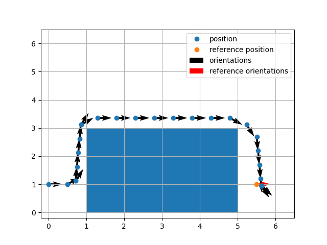

# Model Predictive Control and Approximate Dynamic Programming for a Planar Car

Semester project for *Neurofuzzy Control and Applications*, National Technical University of Athens, March 2023.
The report covers MPC with multistep lookahead, neural-network cost approximation, value iteration around an obstacle,
tracking a moving target under certainty equivalence, and actor-critic control of a 6-D car model.

  
   
  <em>Value iteration: the car drives around the obstacle to the target (Section 2.3).</em>

[Read the report (PDF)](neurofuzzy-control-semester-project.pdf). This is an English translation of the original Greek report.
